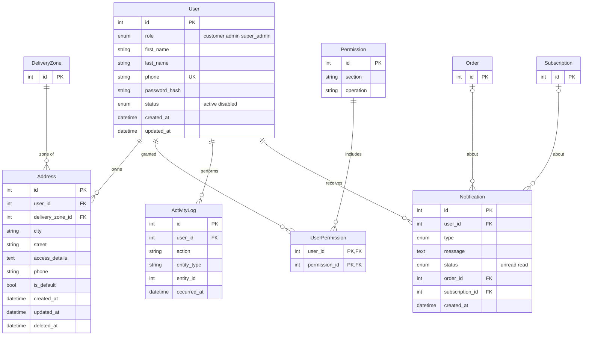
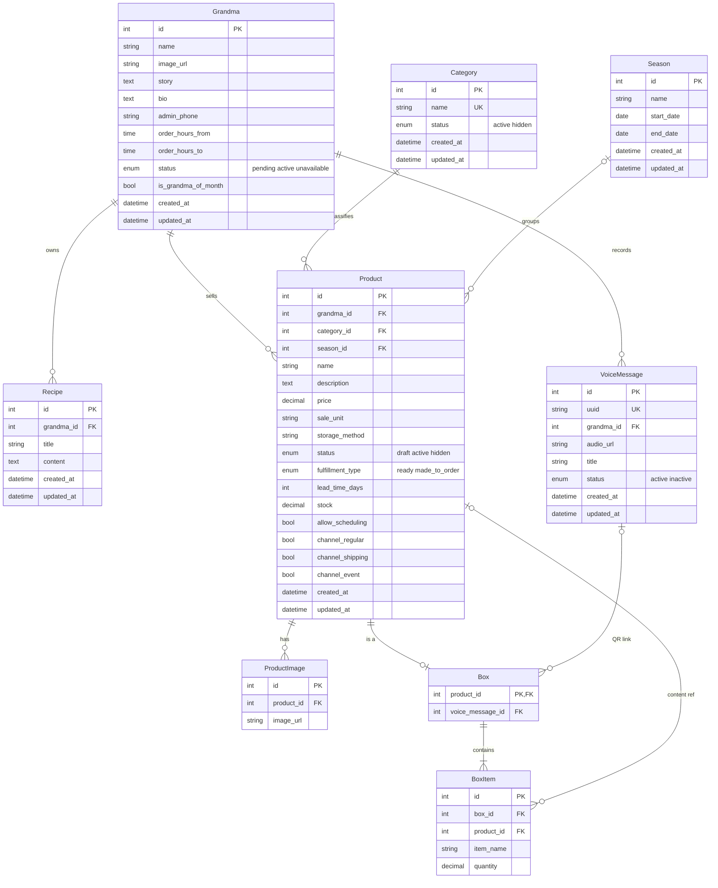
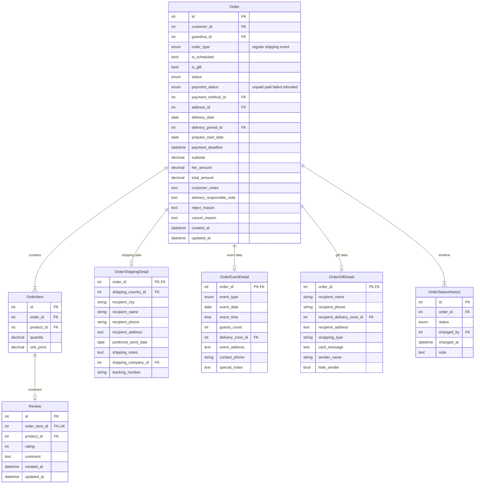
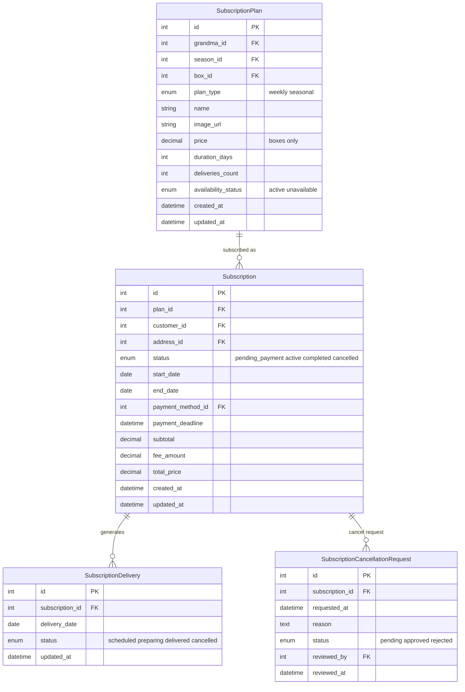
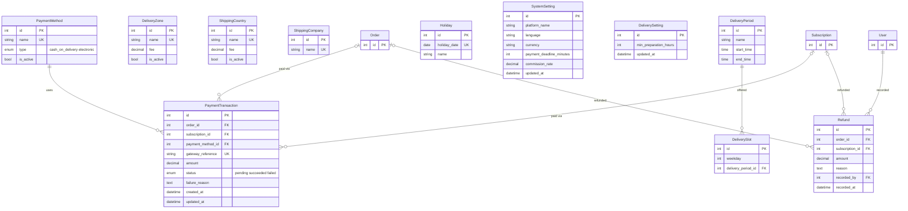

# ERD & Data Model – «Monat Al-Jaddat» (مونة الجدّات) — v2.0 Final

**Source of truth:** `Monat_AlJaddat_Full_Concept_Simplified_Final_v33333333.md` + Architectural Decisions v2.

> **Architectural Decisions Incorporated in v2:**
>
> - **UPDATED — Address Lifecycle (A-06):** Added `deleted_at` (Soft Delete) on `Address`. Updating an address already linked to an `Order` or `Subscription` creates a new row and soft-deletes the old one to preserve historical integrity.
> - **NEW — Payment Transactions (A-13):** Added `PaymentTransaction` table to track electronic payment attempts, gateway references, and failures before/after order creation.
> - **UPDATED — Subscription Pricing (C-01 / C-02):** `SubscriptionPlan.price` represents box contents only. `Subscription` stores `subtotal`, `fee_amount` (`zone.fee × deliveries_count`), and `total_price`. Grandma commission is calculated strictly on `subtotal`.
> - **NEW — Audit Columns (M-16):** Added `created_at` and `updated_at` across core entities.
> - **NEW — Secure QR Token (A-12):** Added unique `uuid` column to `VoiceMessage` for public QR lookups instead of sequential IDs.

---

## 1. Complete Visual ERD Diagrams

Mermaid diagrams: the complete system overview (37 entities) and 5 detailed module diagrams.

### 1.0 System Overview (All 37 Entities)

```mermaid
erDiagram
    User ||--o{ Address : owns
    DeliveryZone ||--o{ Address : "zone of"
    User ||--o{ UserPermission : granted
    Permission ||--o{ UserPermission : includes
    User ||--o{ ActivityLog : performs
    User ||--o{ Notification : receives
    Order |o--o{ Notification : about
    Subscription |o--o{ Notification : about

    Grandma ||--o{ Product : sells
    Category ||--o{ Product : classifies
    Season |o--o{ Product : groups
    Product ||--o{ ProductImage : has
    Product ||--o| Box : "is a"
    Box ||--|{ BoxItem : contains
    Product |o--o{ BoxItem : "content ref"
    Grandma ||--o{ VoiceMessage : records
    VoiceMessage |o--o{ Box : "QR link"
    Grandma ||--o{ Recipe : owns

    User ||--o{ Order : places
    Grandma ||--o{ Order : prepares
    Order ||--|{ OrderItem : contains
    Product ||--o{ OrderItem : "ordered as"
    Order ||--o| OrderShippingDetail : "shipping data"
    Order ||--o| OrderEventDetail : "event data"
    Order ||--o| OrderGiftDetail : "gift data"
    Order ||--|{ OrderStatusHistory : timeline
    User |o--o{ OrderStatusHistory : "changed by"
    OrderItem ||--o| Review : reviewed
    Product ||--o{ Review : "rated in"
    Address |o--o{ Order : "delivered to"
    DeliveryPeriod |o--o{ Order : period
    PaymentMethod |o--o{ Order : "paid with"
    ShippingCountry ||--o{ OrderShippingDetail : destination
    ShippingCompany |o--o{ OrderShippingDetail : "carried by"
    DeliveryZone ||--o{ OrderEventDetail : "event zone"
    DeliveryZone |o--o{ OrderGiftDetail : "recipient zone"

    Grandma ||--o{ SubscriptionPlan : offers
    Season |o--o{ SubscriptionPlan : groups
    Box |o--o{ SubscriptionPlan : "plan box"
    SubscriptionPlan ||--o{ Subscription : "subscribed as"
    User ||--o{ Subscription : subscribes
    Address ||--o{ Subscription : "delivered to"
    PaymentMethod |o--o{ Subscription : "paid with"
    Subscription ||--o{ SubscriptionDelivery : generates
    Subscription ||--o{ SubscriptionCancellationRequest : "cancel request"
    User |o--o{ SubscriptionCancellationRequest : "reviewed by"

    Order |o--o{ PaymentTransaction : "paid via"
    Subscription |o--o{ PaymentTransaction : "paid via"
    PaymentMethod ||--o{ PaymentTransaction : uses
    Order |o--o{ Refund : refunded
    Subscription |o--o{ Refund : refunded
    User ||--o{ Refund : recorded

    DeliveryPeriod ||--o{ DeliverySlot : offered
    SystemSetting
    DeliverySetting
    Holiday
```



### 1.1 Module 1 – Access & Customer Data



### 1.2 Module 2 – Catalog (Grandmas, Products, Boxes)



### 1.3 Module 3 – Orders & Reviews



### 1.4 Module 4 – Subscriptions



### 1.5 Module 5 – Payments, Transactions, Delivery & Settings



---

## 2. Updated & New Table Specifications

### 2.1 Address — UPDATED

| Attribute | Type | Key | Null | Unique | Description |
|---|---|---|---|---|---|
| id | ID (int/uuid) | PK | N | Y | Primary Key |
| user_id | ID | FK → User | N | N | Customer account owner |
| delivery_zone_id | ID | FK → DeliveryZone | N | N | Selected from active service zones |
| city | string | | N | N | City name |
| street | string | | N | N | Street details |
| access_details | text | | Y | N | Building / floor / landmark notes |
| phone | string | | N | N | Contact phone for delivery |
| is_default | bool | | N | N | Partial unique index per user where `deleted_at IS NULL` |
| created_at | datetime | | N | N | Creation timestamp |
| updated_at | datetime | | N | N | Last update timestamp |
| deleted_at | datetime | | Y | N | **Soft delete timestamp.** Prevents breaking historical Orders/Subscriptions. |

### 2.2 VoiceMessage — UPDATED

| Attribute | Type | Key | Null | Unique | Description |
|---|---|---|---|---|---|
| id | ID (int) | PK | N | Y | Internal Primary Key |
| uuid | varchar(36) | UK | N | Y | **Public QR Token.** Used in public QR endpoint to prevent IDOR enumeration. |
| grandma_id | ID | FK → Grandma | N | N | Recording owner |
| audio_url | string | | N | N | Storage URL of audio file |
| title | string | | Y | N | Display title |
| status | enum(active, inactive) | | N | N | Controls public QR playback access |
| created_at | datetime | | N | N | Creation timestamp |
| updated_at | datetime | | N | N | Last update timestamp |

### 2.3 SubscriptionPlan & Subscription — UPDATED

| Entity | Attribute | Type | Key | Null | Description |
|---|---|---|---|---|---|
| **SubscriptionPlan** | price | decimal(10,2) | | N | **Boxes price only** (excludes delivery fees). |
| **Subscription** | subtotal | decimal(10,2) | | N | Snapshot of `SubscriptionPlan.price` at checkout. Basis for grandma commission. |
| **Subscription** | fee_amount | decimal(10,2) | | N | Calculated as `DeliveryZone.fee × deliveries_count` at checkout. |
| **Subscription** | total_price | decimal(10,2) | | N | `subtotal + fee_amount` (Total paid upfront electronically). |
| **Subscription** | created_at / updated_at | datetime | | N | Audit timestamps |

### 2.4 PaymentTransaction — NEW TABLE

| Attribute | Type | Key | Null | Unique | Description |
|---|---|---|---|---|---|
| id | ID (int/uuid) | PK | N | Y | Internal transaction ID |
| order_id | ID | FK → Order | Y | N | Linked Order (nullable initially for pre-order regular checkout payment) |
| subscription_id | ID | FK → Subscription | Y | N | Linked Subscription |
| payment_method_id | ID | FK → PaymentMethod | N | N | Electronic payment gateway used |
| gateway_reference | string | UK | Y | Y | External payment provider transaction ID (idempotency key) |
| amount | decimal(10,2) | | N | N | Transaction amount |
| status | enum(pending, succeeded, failed) | | N | N | Gateway payment state |
| failure_reason | text | | Y | N | Error message if status = `failed` |
| created_at | datetime | | N | N | Attempt start time |
| updated_at | datetime | | N | N | Webhook/callback confirmation time |

---

## 3. Database Engineering: Constraints & Performance Indexes

### 3.1 Critical Database Constraints

- **Partial Unique Default Address:**
  ```sql
  CREATE UNIQUE INDEX uq_user_default_address ON addresses (user_id) WHERE is_default = true AND deleted_at IS NULL;
  ```
- **Single Grandma of the Month:**
  ```sql
  CREATE UNIQUE INDEX uq_grandma_of_month ON grandmas (is_grandma_of_month) WHERE is_grandma_of_month = true;
  ```
- **Exclusive Transaction Target** on `PaymentTransaction`:
  ```sql
  CHECK (NOT (order_id IS NOT NULL AND subscription_id IS NOT NULL))
  ```
- **Financial Integrity:** `CHECK (total_amount = subtotal + fee_amount)` on `Order`, and `CHECK (total_price = subtotal + fee_amount)` on `Subscription`.
- **Made-to-Order Rule** on `Product`:
  ```sql
  CHECK (fulfillment_type != 'made_to_order' OR (lead_time_days > 0 AND allow_scheduling = true))
  ```

### 3.2 Recommended Performance Indexes

| Table | Index Columns | Purpose |
|---|---|---|
| `Order` | `(customer_id, status, created_at DESC)` | Fast filtering in customer "My Orders" page |
| `Order` | `(status, payment_deadline)` | Background Cron Job scanning expired `awaiting_payment` orders |
| `Order` | `(grandma_id, status, delivery_date)` | Admin dashboard filters and Grandma dues report |
| `Product` | `(grandma_id, category_id, status)` | Catalog browsing & filtering |
| `SubscriptionDelivery` | `(subscription_id, status, delivery_date)` | Upcoming deliveries dashboard & customer tracking |
| `Subscription` | `(status, payment_deadline)` | Background Cron Job expiring unpaid subscriptions |
| `Notification` | `(user_id, status, created_at DESC)` | Unread notification badge & inbox list |
